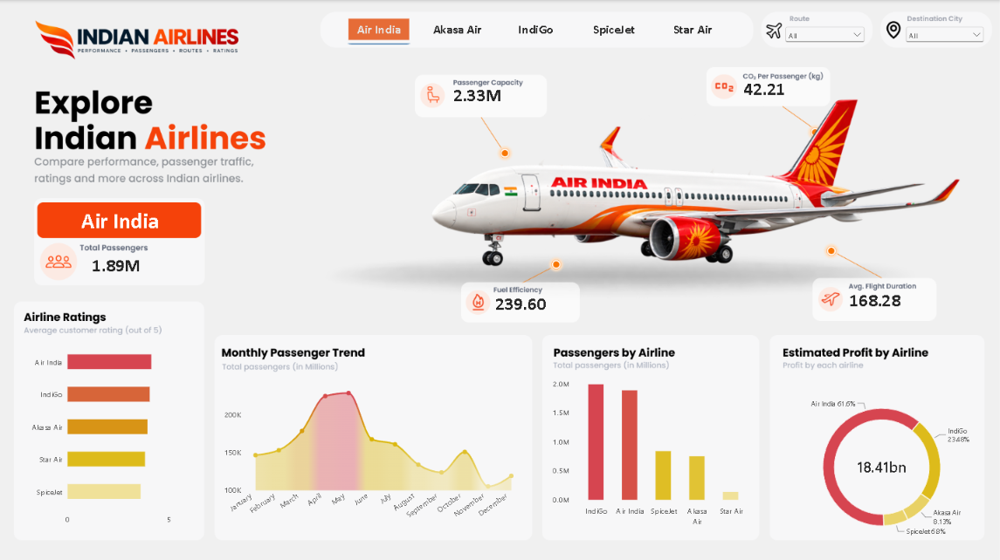

# Indian Airlines Analysis Dashboard

An interactive Power BI project for analyzing the performance of Indian airlines. The dashboard compares passenger traffic, airline ratings, routes, operational efficiency, aircraft capacity, environmental metrics, and estimated profitability.

## Dashboard Preview



## Project Objective

- Compare performance across Indian airlines.
- Understand monthly passenger trends and route demand.
- Analyze capacity, fuel efficiency, flight duration, and CO2 emissions.
- Identify the highest- and lowest-performing airlines.
- Present operational insights through a clear, interactive dashboard.

## Tools Used

- **Microsoft Power BI** - Data modeling, DAX calculations, filters, and visualization
- **Microsoft Excel** - Source dataset and supporting airline information
- **Power Query** - Data cleaning and transformation
- **Power BI Visualizations** - Charts, cards, slicers, and KPI reporting

## Dataset

The dataset is stored in `1-data/indian_airlines_dataset.xlsx`. It contains flight-level operational records, including:

- Flight and airline details
- Aircraft model and capacity
- Origin and destination airports and cities
- Distance and route information
- Scheduled and actual timing
- Departure and arrival delays
- Passenger count and load factor
- Ticket fare and revenue
- Cancellation and on-time status

## Dashboard Features

- Airline-level passenger totals
- Monthly passenger trend analysis
- Airline ratings comparison
- Passenger distribution by airline
- Estimated profit by airline
- Passenger capacity and fuel efficiency KPIs
- CO2 emissions per passenger
- Average flight duration
- Route and destination city filters

## Key Insights

- Air India and IndiGo are the leading airlines by passenger volume.
- Passenger traffic peaks during the summer travel period.
- Air India contributes the largest share of estimated profit.
- A small number of airlines account for a major share of total passengers.
- Capacity, on-time performance, and load factor vary across airlines and routes.
- Traffic and operational patterns indicate opportunities for route and capacity optimization.

> Insight values and rankings may vary with filters because the dashboard is interactive.

## Project Structure

```text
airline-analysis/
|
├── README.md
|
├── 1-data/
│   └── indian_airlines_dataset.xlsx
|
├── 2-power-bi-dashboard/
│   ├── airline_analysis.pbix
│   ├── templates/
│   │   └── dashboard_template.png
│   |
│   └── screenshots/
│       └── dashboard_overview.png
|
└── .gitignore
```

## How to Use

1. Download or clone this repository.
2. Open `2-power-bi-dashboard/airline_analysis.pbix` in Microsoft Power BI Desktop.
3. Use the airline, route, and destination filters to explore the report.
4. Review the dashboard screenshots in `2-power-bi-dashboard/screenshots/`.

## Files

- `1-data/indian_airlines_dataset.xlsx` - Source data
- `2-power-bi-dashboard/airline_analysis.pbix` - Interactive Power BI report
- `2-power-bi-dashboard/templates/dashboard_template.png` - Dashboard template image
- `2-power-bi-dashboard/screenshots/dashboard_overview.png` - Dashboard preview
